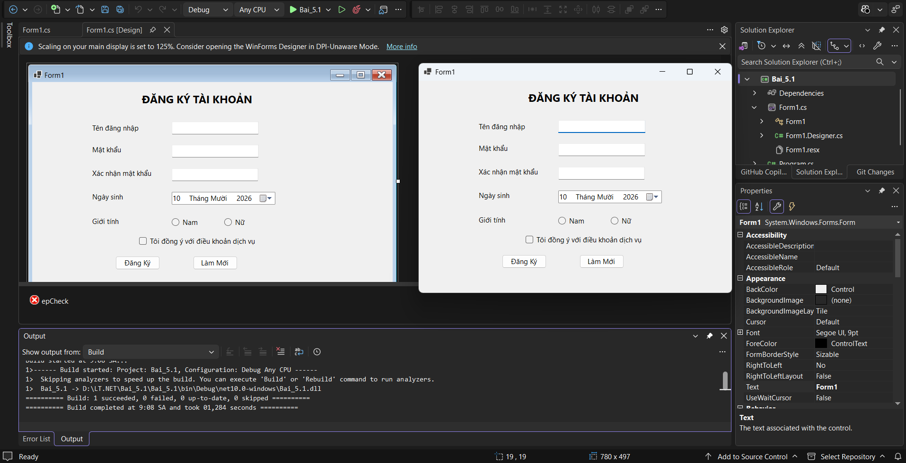
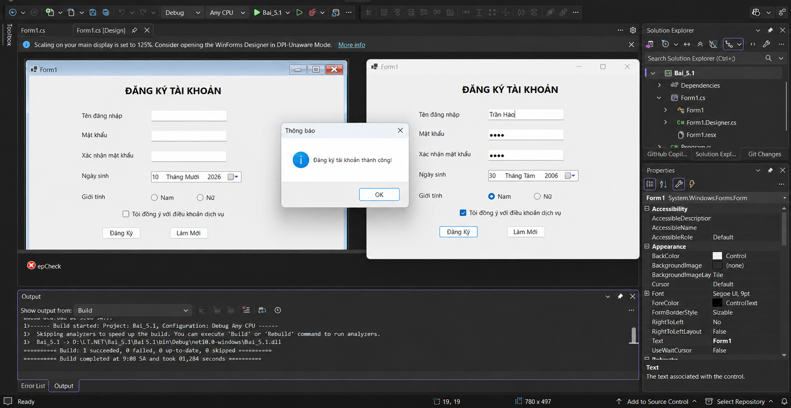
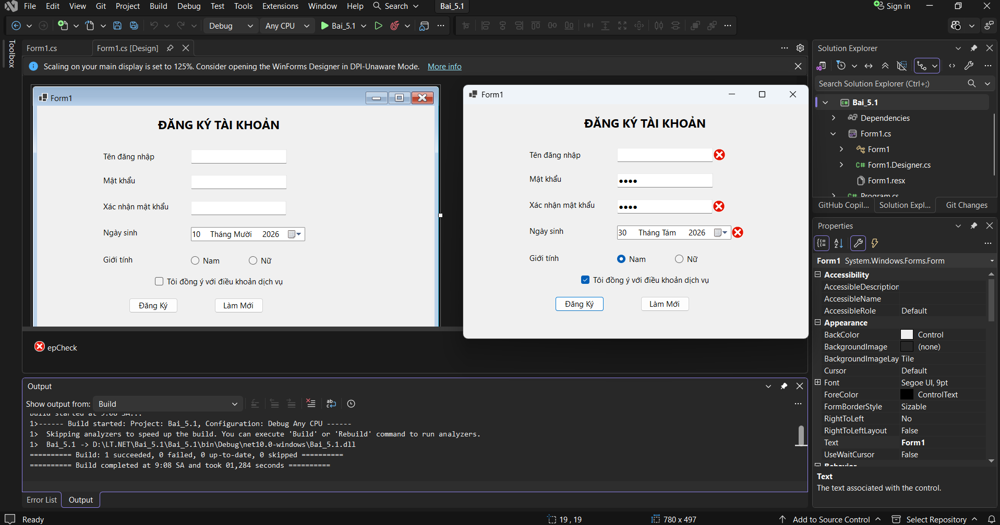
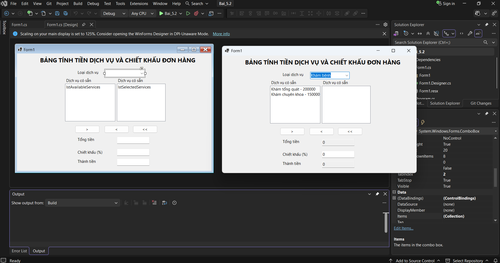
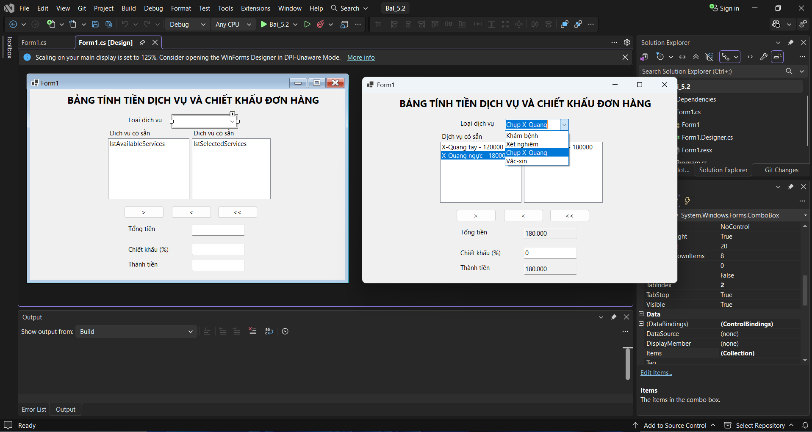
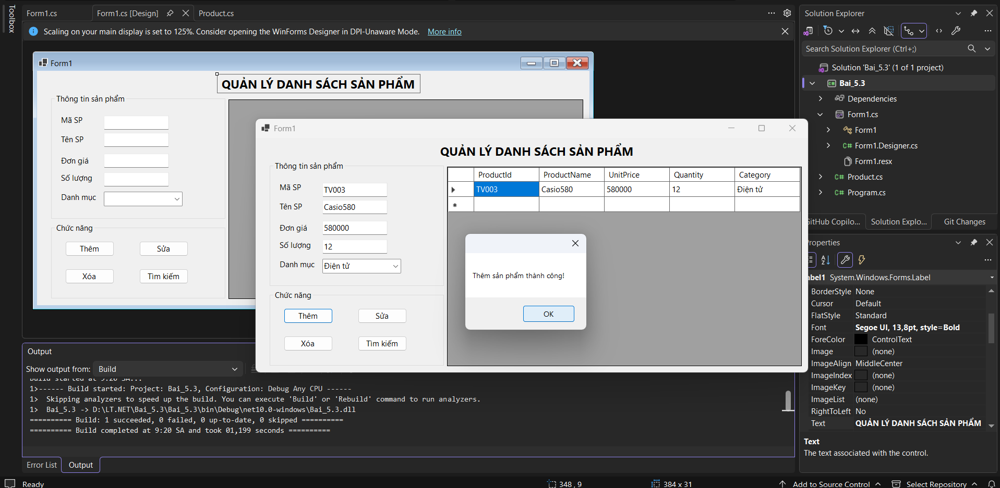
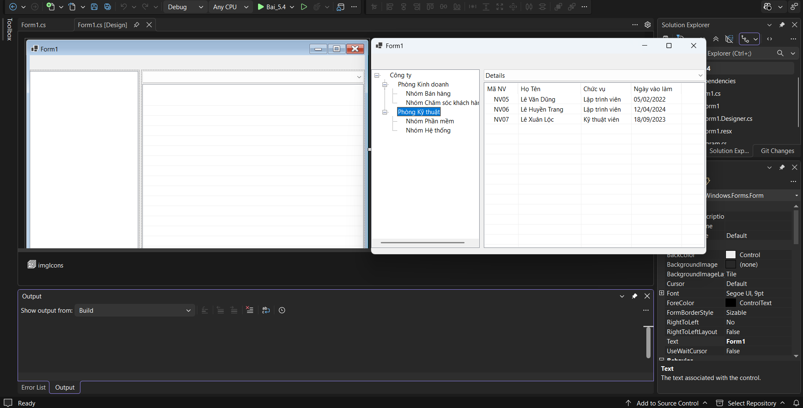
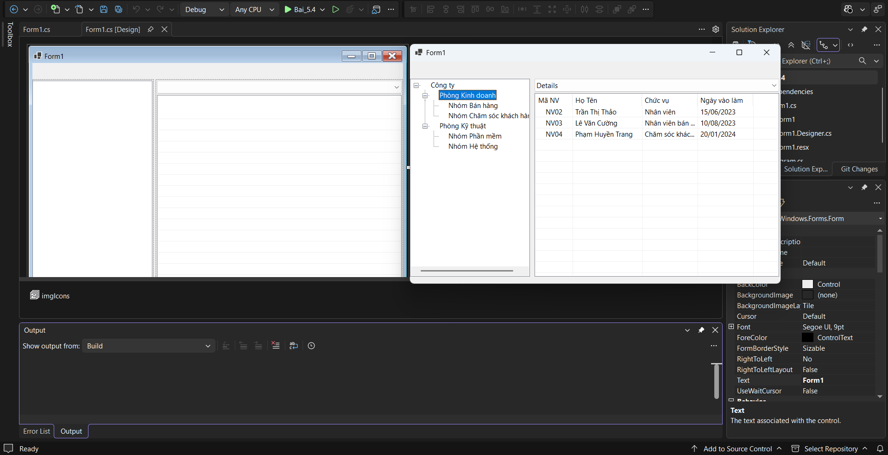

# BÀI TẬP WINDOWS FORMS - 10/10/26

## THÔNG TIN SINH VIÊN
- **Họ và tên:** Trần Thế Hào
- **Mã số sinh viên:** 24810320120
- **Lớp:** D19QTANM1
- **Tên môn học:** Lập trình C# / Windows Forms
- **Tên bài tập:** Bài tập 5.1 - 5.4

---

## DANH SÁCH BÀI TẬP
BÀI 5.1: FORM ĐĂNG KÝ TÀI KHOẢN VÀ BẮT LỖI GIAO DIỆN(ERRORPROVIDER) [Bai_5.1](./Bai_5.1) |
BÀI 5.2: BẢNG TÍNH TIỀN DỊCH VỤ VÀ CHIẾT KHẤU ĐƠN HÀNG(LISTBOX & COMBOBOX) [Bai_5.2](./Bai_5.2) |
BÀI 5.3: FORM QUẢN LÝ DANH SÁCH SẢN PHẨM TRONG BỘ NHỚ(DATAGRIDVIEW CƠ BẢN) [Bai_5.3](./Bai_5.3) |
BÀI 5.4: TRÌNH QUẢN LÝ TẬP TIN DẠNG CHUYÊN NGHIỆP(TREEVIEW & LISTVIEW) [Bai_5.4](./Bai_5.4) |

---

## KẾT QUẢ THỰC HÀNH

### Bài 5.1

### Bài 5.2

### Bài 5.3

### Bài 5.4

---
